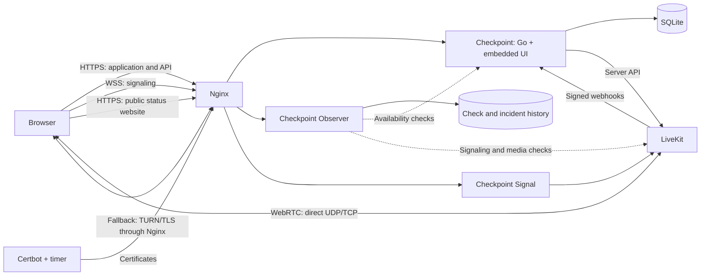

# Checkpoint architecture

The current architecture uses one server. Recording and minutes are described in a [separate document](meeting-minutes.md); operational limitations are listed below.

## Architecture

### Components

| Component | Responsibility | Deployment |
|---|---|---|
| Checkpoint | Web UI, HTTP API, authentication, rooms, invitations, roles, moderation, update management | One Go binary, systemd service |
| Checkpoint Signal | RTC join/validate checks and a WSS proxy independent of core restarts | The same binary, separate `signal` service |
| Checkpoint Observer | Public observability website, checks, availability and incident history | The same Go binary with `observe`, separate systemd service |
| LiveKit | WebRTC, audio, video, screen sharing, signaling, and built-in TURN | Separate official binary, systemd service |
| Nginx | HTTPS, WebSocket reverse proxy, TLS traffic routing on one IP | System package with stream/ssl_preread, systemd service |
| Certbot | Certificate issuance and renewal | System package, timer, and deploy hook |
| SQLite | Persistent application data | Local files, no separate service |

The built React interfaces for the main app and observability website are embedded in the Go binary. Node.js is needed at build time, not on the user's VPS. Redis is not part of the base single-server setup; recording is handled by separate processes of the same binary and local models.

Observer runs as a separate process with its own history database and listener behind Nginx. Serving its public pages should not depend on the HTTP API, authentication, or availability of the main application SQLite database. This adds a service, but no new language, external service, or mandatory Prometheus/Grafana stack.

Checkpoint integrates with LiveKit through public SDKs and APIs, without embedding internal server packages. Compatible versions are pinned and integration-tested.

### Processes and state

The base Docker environment uses four services: `checkpoint serve`, `checkpoint signal`, `checkpoint observe`, and official LiveKit. The three Checkpoint commands share one binary with the embedded UI. Accounts, rooms, roles, invitations, and current messages are stored in SQLite schema 5; old JSON is imported only through an explicit command.

`signal` is a separate process that validates and proxies only RTC join/validate. It checks signatures, token expiration, and membership in a persisted session/room, then replaces grants with subscribe-only permissions. Core applies current publishing rights through the LiveKit API once per second. An old publishing token alone cannot restore that permission. In self-hosted LiveKit, permission changes do not revoke previously issued tokens: see the [upstream limitation](https://docs.livekit.io/frontends/reference/tokens-grants/).

Proxying signaling inside core was tested and rejected: stopping core caused the SDK to recreate its connection and interrupted RTP. A separate `signal` process keeps the WebSocket alive independently of core, as verified by an integration test. Stopping signal itself may affect connections and needs separate verification; process separation is not redundancy.

Signal is included in native systemd setup and reads SQLite through a read-only connection. It checks expiration, revocation, meeting generation, invitations, and disabled accounts. Core reconciles publishing rights and screen leases; core downtime delays applying changed rights to active media connections but does not bypass checks on new joins. [Detailed access model](access.md).

In the Docker profile, LiveKit runs in a bridge namespace: its API is exposed on loopback, while UDP/TCP media is bound only to the Tailscale IPv4 explicitly advertised in ICE. This replaces the initial `network_mode: host` proposal because LiveKit's TCP mux listens on a wildcard address and the operator cannot configure the host firewall. See [local setup](testing.md#local-environment) for details and limitations.

### Connection layout

The native profile runs the same binary as separate core/signal/Observer systemd services. [Setup and listener layout](native-setup.md#https-and-turn) add Nginx stream SNI routing, HTTPS/WSS and TURN TLS termination, Certbot, and the host firewall. Internal TURN listens on 5349 and advertises 443; certificate renewal does not require restarting LiveKit. The first supported profile is a direct public IPv4 without NAT or AAAA. Every VPS must be checked from external networks.

The application does not proxy ordinary media streams. Checkpoint handles control and data; LiveKit and the network carry call traffic.

### State separation

- **SQLite:** users, login sessions, rooms, invitations, roles, access policy, meeting records, and logs of administrative actions and applied updates.
- **LiveKit:** current participant connections, media tracks, and transport state.
- **Checkpoint memory:** short-lived UI events and caches recoverable from persistent data and LiveKit state.
- **Observer:** an independent store of measurements, incident history, and scheduled maintenance. An application database failure should not deprive the status website of its own history.

Webhook processing verifies signatures and is idempotent. After a restart, Checkpoint reconciles active sessions with LiveKit; correctness must not depend on exactly-once webhook delivery.

Updating Checkpoint does not require restarting LiveKit. Preserving established media connections during that update is a separate acceptance test; joining, moderation, and reconnects may briefly require application availability.

## Room authorization

SQLite schema 5 stores room ownership and persistent `room_admins` grants; hashed one-time invitations for that role are stored in `room_admin_invites`. An account receives a room directory limited by its own grants. Platform-wide administration uses the local CLI; the legacy admin flag does not expand web permissions.

Ordinary guest access relies on knowing a random 80-bit room ID. Link secrets are carried in URL fragments and exchanged by the server for limited sessions. Legacy invitation TTL/use/revocation rules are supported separately. The owner grants Room Admin through a one-time link accepted by a signed-in account. Destructive operations check ownership specifically, not just the moderator flag. See [access](access.md).

## Networking, HTTPS, and TURN

Suggested DNS names pointing to one public IP:

- `meet.example.com` — application.
- `rtc.example.com` — LiveKit signaling.
- `turn.example.com` — TURN/TLS.
- `status.example.com` — a separate public observability website without sign-in; setup includes its certificate and routing.

Nginx accepts inbound TCP 443 and routes connections by SNI. HTTPS/WSS and TURN/TLS use separate internal handlers. An ordinary HTTP reverse proxy does not replace TCP proxying for TURN.

| Public port | Purpose |
|---|---|
| TCP 80 | ACME HTTP-01 and HTTP redirects |
| TCP 443 | HTTPS, WSS, TURN/TLS |
| UDP 7882 | LiveKit single UDP port |
| TCP 7881 | Direct WebRTC TCP fallback |
| UDP 3478 | TURN/UDP, if enabled by the selected configuration |

Setup implements this layout, tested in an isolated Ubuntu environment: advertised TURN port, SNI, TLS termination, direct/relay media, and certificate reload. Local tests do not replace ACME and external-network verification on the actual VPS.

TLS terminates at Nginx so certificate renewal does not require a LiveKit restart. The setup uses `turn.external_tls: true`, an internal listener on 5349, and a trusted PROXY header from loopback Nginx; browsers see TURN/TLS on 443. [Exact layout and limitations](native-setup.md#https-and-turn).

Management APIs, SQLite, internal ports, and metrics are not directly public. Check the provider firewall and local firewall separately. TURN/TLS improves availability on restricted networks but does not guarantee access through every corporate policy.

Setup detects occupied ports and existing web servers. It does not automatically overwrite unrelated configuration; those VPS installations need a documented integration mode.

## Deployment boundaries

All components run on one VPS. Process separation allows independent maintenance, but a host or network failure stops the service. Clustering, media-session redundancy, and distributed storage are not supported.

## Related documents

- [Access and room roles](access.md)
- [Observability website](observability.md)
- [Operations](operations.md)

## Current implementation limits

Application SQLite uses schema 5, foreign keys, short immediate transactions, FULL synchronous, and DELETE journaling for read-only signal access. Observer uses a separate SQLite schema 1. One binary serves three application services alongside official LiveKit; Node is needed only at build time. The updater currently permits only schema 5 and LiveKit 1.13.11. LiveKit's 200-participant room limit is a technical guardrail, not a capacity claim. Local tests do not replace VPS acceptance testing.

## Recording and minutes

Implemented components include a core/SQLite queue, separate recorder and processor processes, a private archive, and a local generator. The recorder uses the Go SDK, WebM, and FFmpeg; ASR uses faster-whisper medium, and generation uses llama.cpp/Qwen3-4B. The combined mix is created during finalization, and individual audio is deleted after ASR. Jobs use lease/cancellation fencing; deleted data is tracked in an independent ledger. Services run under separate UIDs and exchange artifacts through a restricted Unix API. See [recording limitations and specification](meeting-minutes.md) and [operations](operations.md#recording-setup-and-management).

## Interface localization

The interface uses shared ru/en catalogs and the account setting `ui_locale=auto|en|ru`. Manual selection takes priority; automatic mode uses browser languages (`navigator.languages`), with English as fallback. Guest preferences stay local; Observer does not depend on the main app's account cookie. APIs return stable error codes/parameters, and the UI formats localized messages. Interface language does not change meeting content or ASR/generator settings. The implementation uses i18next/react-i18next and embedded JSON catalogs; schema 5 stores preferences only for the user's own profile. The server does not select a language: HTML is shared, and navigator.languages is applied before the first meaningful render.
